# openPangu-GenRec-Infer：昇腾950亲和的生成式推荐推理系统

openPangu · Ascend 950

## 目录

- [一、 背景与挑战](#section-1)
- [二、 低时延生成式推荐推理系统openPangu-GenRec-Infer](#section-2)
  - [2.1 整体计算流：PD时域分离架构](#section-3)
  - [2.2 系统技术点概览](#section-4)
- [三、 生成式推荐低时延推理引擎GR-Engine](#section-5)
  - [3.1 LiteAttention：Beam Search优化Pipeline](#section-6)
  - [3.2 Layer-wise掩盖与成图优化](#section-7)
- [四、 生成式推荐调度与并发优化 GR-Scheduler](#section-8)
  - [4.1 Multi-Stream Parallelism：限核多流并行](#section-9)
  - [4.2 Asynchronous scheduling：异步调度](#section-10)
  - [4.3 LiteScheduler：轻量化框架加速](#section-11)
- [五、 生成式推荐异构池化加速 GR-Cache](#section-12)
  - [5.1 User-Wise KVCache Manager：用户粒度KV管理](#section-13)
  - [5.2 LiteCache：Cache多级缓存及Embedding与KV联合管理](#section-14)
  - [5.3 LiteTransfer：传输引擎优化](#section-15)
  - [5.4 Fullgraph Layerwise Pipeline：整图下计算流与池化load的掩盖方案](#section-16)
- [六、 生成式推荐推理系统性能分析](#section-17)
- [七、 总结与展望](#section-18)
  - [7.1 工作总结](#section-19)
  - [7.2 未来工作与 Roadmap](#section-20)
- [参考文献](#section-21)

本技术报告系统介绍了基于昇腾开展的生成式推荐推理系统openPangu-GenRec-Infer端到端设计与优化实践。生成式推荐范式在长序列复杂语义建模、多样性推荐及算力亲和架构上展现出巨大潜力，已成为互联网提升业务效果的关键路径。然而，生成式推荐推理仍面临严峻性能挑战，端到端时延往往无法满足高吞吐下的性能SLA。为此，openPangu团队构建了openPangu-GenRec-Infer推理加速系统，在openPangu的低时延推荐系统实践中，通过低时延推理引擎、调度并发优化和异构池化加速模块，实现推理性能加速&gt;90%。相关系统已在终端云上线部署，为基于昇腾的生成式推荐推理提供了重要实践支撑，同时openPangu团队已将多个技术合入vLLM社区开源项目vLLM-GR（https://github.com/vllm-project/vllm-gr）并参与共建。本报告中涉及的技术均将陆续开源，也祝愿同行者基于此实践实现更大的突破。

## 一、 背景与挑战

推荐系统是互联网业务的命脉，驱动着内容分发、广告投放和用户增长。传统深度学习推荐模型(DLRM)的规模扩张由嵌入表参数主导（占比超99.99%），TB级模型精度已近饱和，继续扩大规模收益有限\[1\]。2024年，Meta提出基于HSTU的生成式推荐架构GR\[2\]，参数量达1.5万亿，算力需求与GPT-3持平，在线部署后观看时长提升8%–10%。此后，生成式推荐从理论走向工业实践，2025—2026年期间技术路径呈现多元分化：快手推出OneRec\[3\]，以原系统1/10的服务成本端到端重构推荐链路；美团提出MTGR\[4\]，在保留DLRM交叉特征优势的同时实现规模化部署。字节跳动提出LONGER\[5\]聚焦长序列建模，OneTrans\[6\]以统一Transformer主干融合序列建模与特征交互；Meta推出ULTRA-HSTU\[7\]，训练与推理扩展速度分别提升5倍和21倍。这些突破迅速点燃了业界对生成式推荐的热情，国内头部厂商纷纷公开其生成式推荐实践。生成式推荐的高算力需求带来新的增长空间，但其超低延迟推理特性对系统提出苛刻挑战，驱动芯片与架构的创新。本文聚焦LLM for Rec中的自回归生成式推荐：将物品表示为离散语义ID（Semantic ID，SID），由语言模型根据用户历史与上下文，自回归生成候选物品的 SID，再映射回业务物品，重点讨论这一过程中的推理系统设计与优化。

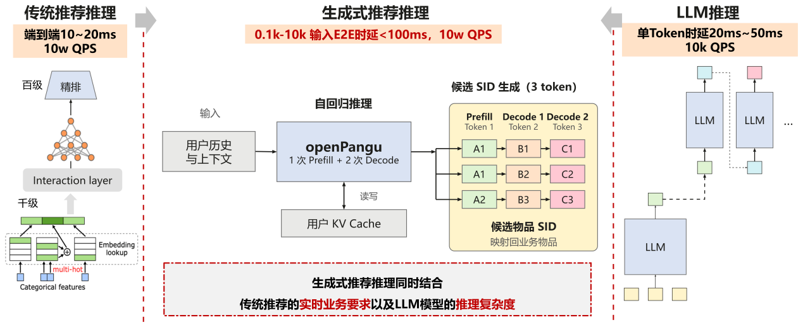

**图1  生成式推荐推理特性**

主流推理框架如vLLM和SGLang重点围绕通用LLM设计，其优化目标与生成式推荐差异显著。如图1所示，生成式推荐推理既要求传统推荐的实时性，又具备LLM级的计算复杂度，其独有特性如Beam Search计算和用户粒度KV Cache管理等在现有框架中缺乏支持，直接迁移会引发一系列计算效率问题。表1展示了基于vLLM推理框架的openPangu-1B-Rec模型在不同序列长度下的推理时延分解：

**表1 openPangu-1B-Rec模型性能基线瓶颈分析**

| 机器 | 序列长度 | Beam Width | Prefill（ms） | KV拉取（ms） | Decode（ms） | 性能优化基线端到端时延（ms） |
| --- | --- | --- | --- | --- | --- | --- |
| A2 | 1k | 128 | 29 | 5.87 | 201 | 230 |
| A2 | 10k | 128 | 268 | 61.91 | 1062 | 1330 |
| 950 | 1k | 128 | 17 | 2.58 | 91 | 108 |
| 950 | 10k | 128 | 161 | 27.2 | 338 | 499 |

**挑战一：Decode阶段计算时延过高，单次推理远超SLA要求**

从表1可见，Decode阶段耗时在端到端时延中占主导，是推理时延的首要瓶颈。根源在于生成式推荐与通用LLM的Decode计算模式不同：LLM逐token生成受限于显存带宽，PD分离、投机解码等优化均针对这一访存密集型特性；而GR采用Beam Search生成，导致Decode阶段计算量较大，现有LLM优化手段收效甚微。即使经基础优化，1K序列下端到端时延仍达230ms，远超100ms SLA要求；10K序列下更增至1330ms，时延为核心瓶颈。

**挑战二：高并发下P99延迟抖动显著，调度系统成为瓶颈**

推荐系统高峰期每秒请求量可达百万级，而单次推理已远超SLA临界值。高并发场景下系统几乎无缓冲吸收延迟抖动——请求排队、计算资源争用、显存带宽竞争，任意环节波动超过十几毫秒，P99时延便可能进一步恶化。通用推理框架的调度与预处理阶段逻辑主要面向LLM场景，在生成式推荐中并不适用，即使模型前向计算本身已充分优化，框架侧的冗余开销仍会影响高并发下的时延稳定性，仅靠压缩单次推理的计算时延难以从根本上解决问题。

**挑战三：PB级KVCache多级卸载，远端拉取引入新的时延瓶颈**

推荐系统需为热点长序列用户维护独立的KVCache，总规模可达到PB量级远超片上内存容量上限。KVCache多级卸载引入关键矛盾，每次推理均需从远端拉取所需KV数据，传输时延成为新的瓶颈。表1数据显示，10K长序列下KV拉取时延已达61.91ms，同时现有以请求为粒度的缓存管理方式导致同一用户的KV Cache被重复计算与加载，进一步加剧了存储与传输压力。

以上挑战相互耦合，单纯增加硬件资源或简单复用现有开源推理框架难以彻底解决问题。因此，需设计一套面向生成式推荐的低时延、高吞吐和可扩展的推理系统。

## 二、 低时延生成式推荐推理系统openPangu-GenRec-Infer

生成式推荐落地面临低延迟、高并发、大缓存三重挑战，亟需从数据流到计算架构全面优化的推理系统。openPangu-GenRec-Infer针对OpenPangu模型，应用开源vLLM推理架构与Mooncake池化引擎\[8\]，针对生成式推荐的独有特性（PD时域分离、轻量化框架加速、用户粒度KV复用等），从推理引擎、调度与并发、异构池化三个维度进行系统优化，有效降低端到端时延并显著提升吞吐。本系统支持昇腾 A2、A3 及 950 系列产品，本文的性能评测与分析主要在 A2 和 950 两个平台上开展。考虑到当前评测以单卡推理为主，且 A3 单 Die 的性能表现与 A2 接近，本文未单独展开 A3 平台的评测。

### 2.1 整体计算流：PD时域分离架构

与常见大模型推理的PD空间分离（Prefill与Decode分至不同设备）不同，openPangu-GenRec-Infer 采用时域分离。根本原因在于生成式推荐的Decode特性：通过Beam Search在访存量不变的前提下增加算力需求，因此不存在空间分离所针对的“显存带宽瓶颈”，通过计算与存储协调即可优化，无需复杂设备拆分。如图2所示，openPangu-GenRec-Infer将KVCache的计算与访问在时间上解耦，分为近线计算和离线计算两种模式，以降低线上推理端到端时延。

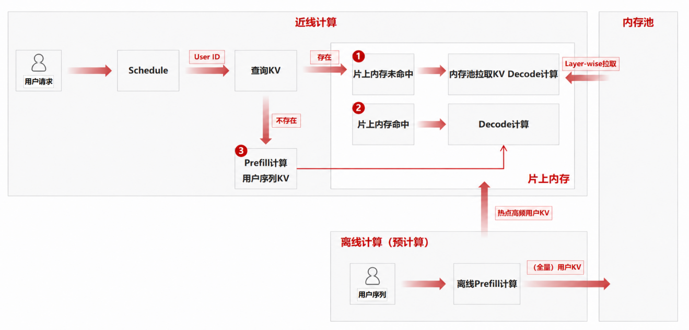

**图2  PD时域分离架构示意图**

近线计算：近线计算模式面临的最大挑战是离线缓存失效的场景。如图3所示，在请求实时处理过程中，Prefill请求的KV计算与Decode请求的特征处理形成掩盖关系。具体而言，当请求进入系统后，通过异步流水线相互重叠，从而部分掩盖KV计算的时间开销，使其对端到端时延的增量控制在可接受范围内。第3章低时延推理引擎和第4章调度与并发优化将重点围绕近线计算的场景展开。

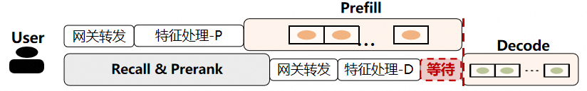

**图3 近线计算示意图**

离线计算：系统可在周期性低峰期提前预计算用户的KV Cache，并将活跃高频用户的KV常驻片上内存，全量或大多数用户的KV存储于Mooncake管理的DRAM池中。当用户请求到达时，系统可直接从片上内存或DRAM读取已计算好的历史KV部分，仅需实时计算新增序列对应的KV，从而大幅降低实时计算开销。离线计算的核心在于KV Cache的存储与管理，通过预计算和分级存储缓解实时计算压力。第5章异构池化加速的实现将重点围绕离线计算的场景展开。

通过PD时域分离，openPangu-GenRec-Infer能够通过近线计算与前置阶段并行处理，通过离线计算复用历史KV，从而在实际推理时间窗口内实现低延迟响应。

### 2.2 系统技术点概览

如图4所示，openPangu-GenRec-Infer的优化技术围绕三大模块展开：低时延推理引擎（GR-Engine）、调度与并发优化（GR-Scheduler）、异构池化加速（GR-Cache），分别对应上述提出的三大挑战。

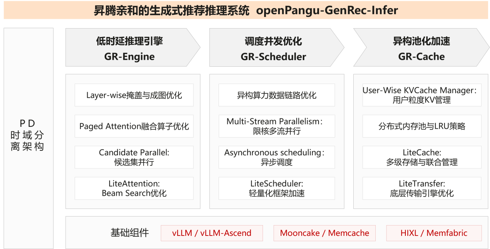

**图4 系统技术点概览**

**主线一：低时延推理引擎（GR-Engine）—应对计算时延过高的挑战**

生成式推荐的请求模式与通用LLM差异显著：序列长短不一、候选集规模波动剧烈，直接复用通用推理引擎将产生大量计算空泡与调度阻塞。GR-Engine从计算图与模型两个层面展开优化：在计算图层，成图推理与Layer-wise流水排布使执行节奏贴合推荐模型的计算特征，Jagged分档解决变长序列对静态图形状的适配问题；在模型层，针对openPangu实现Beam Search向量化并行、请求合一与LiteAttention高效计算，降低冗余的计算时延。

**主线二：调度与并发优化（GR-Scheduler）—应对高并发下的时延波动挑战**

面对高并发场景中单次推理时延余量极小的问题，GR-Scheduler从并发调度与数据链路两个层面保障时延稳定性。在并发调度层，单卡限核多流并行与异步调度机制避免计算单元闲置，充分挖掘单卡资源利用率，同时降低请求排队造成的调度阻塞；在数据链路层，异构数据链路优化在Host与Device之间精简数据搬运路径，压缩传输开销，从系统层面抑制延迟抖动。在此基础上，LiteScheduler对推理前置处理阶段进行轻量化加速，通过移除与生成式推荐无关的冗余计算进一步压缩了调度与预处理开销。

**主线三：异构池化加速（GR-Cache）—应对缓存规模激增与远端传输时延的挑战**

针对KV Cache容量远超片上内存限制、远端拉取耗时突出的问题，GR-Cache以用户粒度重构KV Cache的存储与传输体系。在管理层，用户粒度管理明确了以用户为单位的索引与淘汰边界，LRU淘汰与主动换入完善缓存调度能力；在存储层，LiteCache实现片上内存-DRAM两级管理及Embedding与KV联合管理；在传输层，LiteTransfer实现底层传输引擎优化，降低数据搬运的时延开销。

## 三、 生成式推荐低时延推理引擎GR-Engine

由第一章分析可知，Decode阶段计算时延过高是单次推理超过SLA的首要瓶颈。本章围绕这一瓶颈，从成图优化与模型计算两个层面设计低时延推理引擎GR-Engine：① 通过Layer-wise拉取掩盖将KV加载时延压缩至首层，结合Jagged分档消除变长序列的填充冗余；② 通过LiteAttention消除KV冗余存储，通过请求合一降低预处理和后处理时延。从数据传输、计算并行度和框架优化三个维度压缩端到端推理延迟。

### 3.1 LiteAttention：Beam Search优化Pipeline

在基于语义ID的生成式推荐中，Beam Search是一项特有的挑战，vLLM原生的beam search部分有非常严重的性能瓶颈，主要分为请求调度，Beam选择计算以及后处理三大部分的冗余开销。如图5(a)所示，GR-Engine首先针对 vLLM中Beam Search后处理的串行解码问题，将其改造为并行化实现，通过向量化方式同时处理不同样本以及同一样本内的多个候选项，将批次内各样本的多个候选序列展平合并为一个大批次，统一进行后处理，消除了逐个候选序列依次串行调度的开销。

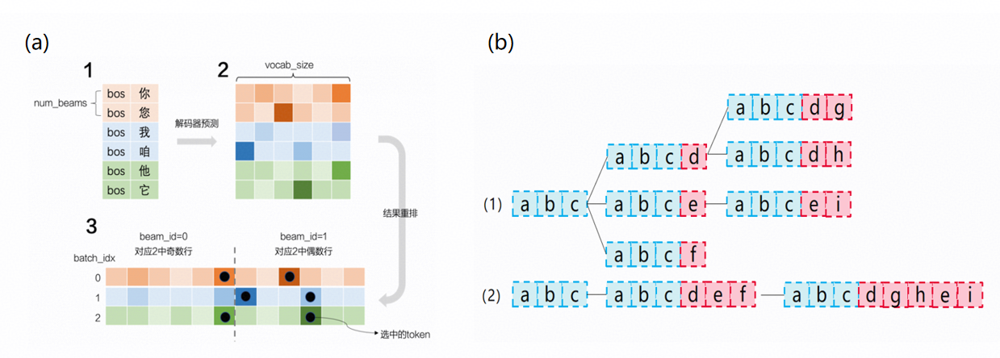

**图5 Beam Search优化示意图**

然而，向量化并行后的整体时延仍不可接受。进一步分析发现，vLLM的Beam Search采用“CPU驱动、全序列计算”的路径：Beam选择逻辑运行在CPU端，需反复将logprobs从NPU搬移至CPU完成TopK筛选后再回传，频繁的NPU↔CPU数据搬运将端到端延迟显著拉高。此外，如图5(b)所示，原始方案里，虽然vLLM的paged KV cache已经让多个beam共享了prompt KV的物理 block，但每个beam在decode阶段产生的token各不相同，对应的KV必须各自占用独立的block。Beam\_width=128时，每一步decode都要为128个beam分别分配新block，随着步数增长存储冗余线性膨胀。

针对上述瓶颈，GR-Engine首先提出LiteAttention重构了注意力计算。旧方案中每个beam独立计算完整paged attention，prompt部分的KV被重复读取Beam\_width次。新方案将KV拆分为共享与非共享两段：共享段存储prompt的KV，所有beam仅存一份；非共享段存储各beam自有的生成部分，按beam维度并行。两段注意力分别计算后，通过online softmax分块合并，数学上等价于完整序列注意力。注意力计算优化后，非共享KV的缓存管理成为关键。每步decode新生成的K/V需写入正确位置，且beam选择后可能发生继承关系变更，KV缓存必须随之重排。GR-Engine通过构造虚拟block实现按decode\_step位置的KV写入，按head分片、按beam并行；对于重排问题，采用双向遍历加同步策略原地更新KV缓存，一次调用跨所有层批量完成，兼顾正确性与效率。最后，将TopK选择与序列重排全部迁移至NPU端执行。

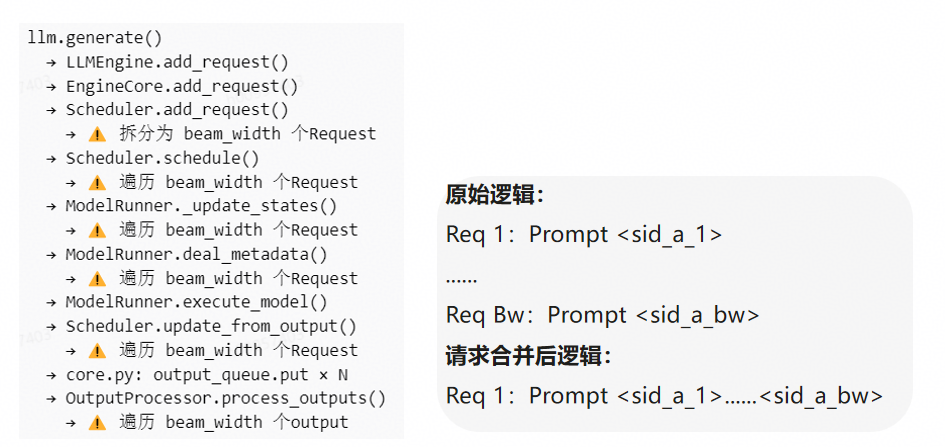

**图6 Beam Search请求合一说明**

此外，如图6所示，当前Beam Search会为每个beam width独立发起请求，分别进行调度、预处理和后处理，带来大量冗余开销。通过将beam width合并到序列长度维度上，可以有效降低这种开销。上述各个优化点带来的性能收益分析详见第六章。在解决Beam Search的性能瓶颈后，GR-Engine结合业务实际需求进一步实现了两项功能完善：

1）受限生成。 在每层解码时，不再直接对全量词表做Top-k，而是基于前缀表，仅保留能够构成真实物品的候选，再在该合法集合内完成Top-k选择与扩展。这样可避免中间步骤产生前缀看似合理、最终却无法映射到真实物品的组合，确保输出始终落在有效物品空间内，同时减少无效候选的扩展与计算，降低推理时延。

2）动态Beam。 固定Beam如 \[512, 512, 512\] 未考虑层级差异。一般来说第一层决定物品主方向，若其分布集中，可用较小 Beam 聚焦高概率语义方向，避免低收益分支向后扩散；后层在已定前缀下做细粒度区分，需逐步放宽 Beam 保留更多候选。因此采用递增Beam如\[128, 256, 512\]，前层聚焦、后层精细，在降低无效扩展与推理时延的同时提升后层召回。若第一层分布平坦或用户兴趣分散，则应反向采用大→小策略：第一层用宽Beam捕获多兴趣，后层逐步收窄以控制时延，实际动态Beam大小可依据每层概率分布自适应选择宽度方向与幅度。

### 3.2 Layer-wise掩盖与成图优化

在PD分离架构下，传统做法是Decode启动前一次性将所有层的KV Cache加载至NPU。由第一章表1可知，10K序列下KV拉取时延已达数十毫秒，传输期间NPU完全空闲，这段等待时间直接叠加到端到端时延。GR-Engine首先针对PD分离架构下KV Cache传输的串行等待问题，将传统“全量同步加载”改为“逐层流水线加载”。如图7所示，利用NPU双流机制，在拷贝流上异步拉取下一层KV Cache的同时，计算流执行当前层Attention计算，每层计算前通过Event同步确保该层KV已就绪。这一设计将Decode侧的KV加载时延从全量串行压缩至接近首层加载时间，后续层传输时间被计算时间全部或部分掩盖。

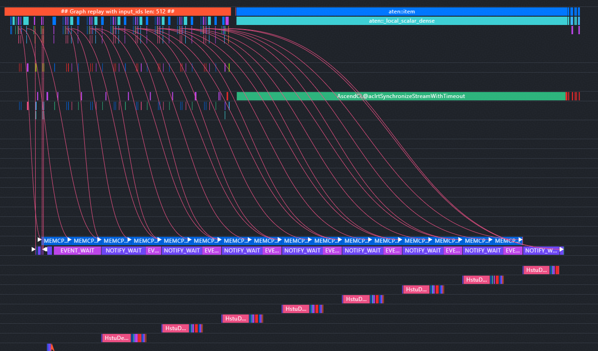

**图7 Layer-wise拉取掩盖示意图**

更进一步，GR-Engine实现了Decode整图回放与Layer-wise KV拉取的融合。openPangu为大语言模型架构，网络层数显著更多，若同样采用逐层下发，Host侧的调度开销将不可忽视）。如图8所示，整图一次调用，层间KV同步与Event等待全部入图，在Device侧自动完成，避免了Host多次介入引入的kernel launch与同步开销。

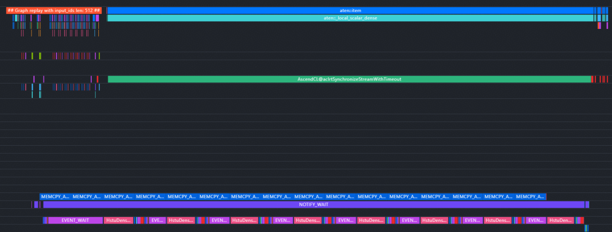

**图8 Decode整图回放与Layer-wise KV拉取**

此外，在推荐系统推理场景中，不同用户的序列长度大小差异显著，导致模型输入的序列长度参差不齐。通常的做法是将每个用户的序列独立填充至最接近的档位长度，再拼接成批次送入模型。这种方式下，每个用户序列各自携带大量填充零值，且用户越多、长度差异越大，冗余计算和内存浪费越严重。针对上述问题，GR-Engine采用Jagged分档方案。如图9所示，先将多个用户的变长序列紧凑拼接，仅对拼接后的总有效长度末尾补充少量零值以满足静态图形状要求。该方案将填充从“逐序列分散”变为“整体一次性”，在保证图捕获加速效果的同时兼顾了推荐模型变长输入的灵活性，显著减少了无效计算占比。

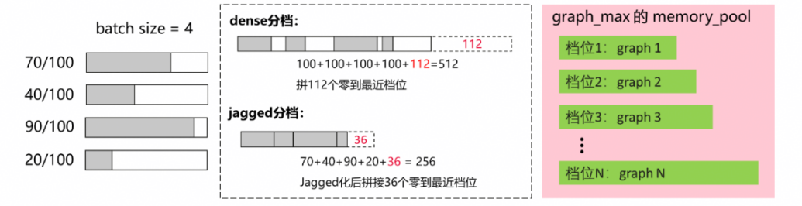

**图9 Jagged分档成图示意图**

## 四、 生成式推荐调度与并发优化 GR-Scheduler

高并发下延迟抖动突出、SLA保障难度加剧，其根源在于请求调度与框架处理环节存在显著的资源浪费与串行等待。本章围绕这一问题，从并发调度、异步流水线与轻量化框架加速三个层面设计GR-Scheduler：通过单卡限核多流并行充分利用闲置算力，通过异步调度实现CPU准备与NPU计算的重叠，通过对推理前置处理阶段的轻量化改造消除冗余开销，协同保障了高并发下的时延稳定性。

### 4.1 Multi-Stream Parallelism：限核多流并行

相比万亿参数规模的LLM模型，当前生成式推荐模型规模相对较小，单次推理计算量不足以填满NPU AI Core。传统单流串行推理模式下，NPU仅在部分时间片内高效工作，大量算力在请求间隙处于空闲状态，硬件潜力远未发挥。针对上述问题，GR-Scheduler采用了单卡限核多流并行技术。如图10所示，将NPU上的AI Core划分为多个独立分区，每个分区绑定一个推理流，在单卡上同时运行多个推理流实现批次并发处理。每个推理流仅使用分配的算力核心子集，流间硬件层面互不干扰，调度器根据实时负载将任务动态分配到空闲流上执行。该方案在不显著增加单流延迟的前提下，将闲置计算核心充分利用，同时摊薄了Host侧调度开销，显著提升了单卡算力占用率与请求吞吐量。

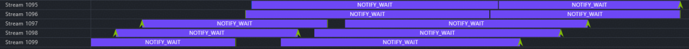

**图10 单卡限核多流并行示意图**

性能效果如表2所示，限核分流对小模型具有时延收益。因为小模型计算量不足以填满全部AI Core，10M模型不限核时Matmul算子Cube利用率仅10.6%、Mul Vector利用率低至0.7%，大量算力在请求间隙空闲浪费。通过限核分流，每流分配更少但更匹配的核心，单层dense计算时延并未显著增加（100M模型10 Cube/20 Vector配置下470μs，与不限核基线460μs仅差2.2%），而利用率大幅提升（MatMul Cube 利用率提升11.8%，Mul Vector从1.18%升至5.68%，近5倍）。限核后单流计算效率反而更高，多流并行带来的吞吐增益几乎无需付出额外时延代价。

**表2 单卡限核数值测试结果**

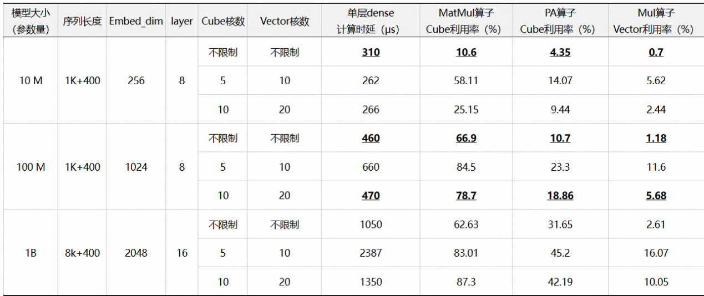

### 4.2 Asynchronous scheduling：异步调度

在同步推理模式下，每一步需严格遵循“CPU状态更新与输入准备→NPU前向计算→CPU输出及后处理→CPU状态更新与输入准备→下一轮NPU计算”的串行流程，CPU与NPU交替等待，在每一步之间引入明显的空闲间隙。随着ACL Graph等优化手段不断压缩NPU计算时间，CPU端的串行开销在总耗时中的占比愈发突出，成为限制推理吞吐的核心瓶颈。针对这一问题，GR-Scheduler引入异步调度机制。如图11所示，调度器在提交一轮计算后不再阻塞等待，而是直接启动下一轮的调度决策与输入准备。同时，采样结果通过独立的数据拷贝流异步回传至CPU，保证了正确性的前提下实现CPU调度准备与NPU前向计算的最大化重叠。

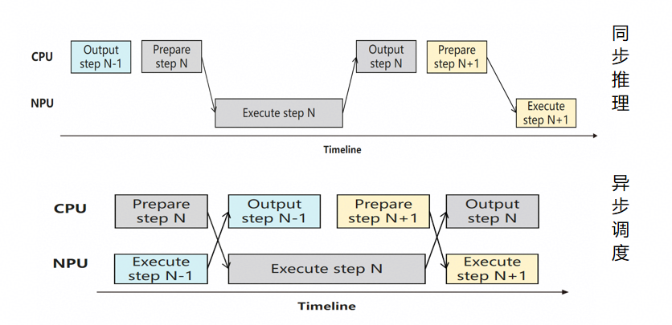

**图11 异步调度示意图**

在生成式推荐场景中，不同模型的数据依赖特征使得异步调度的适用方式有所差异。与LLM需记录新生成token id不同，GR需记录新生成的语义ID、对应的logprob以及序列组合信息。为此，GR-Scheduler在NPU端开辟专用存储空间，直接完成上述结果的传递，避免将数据搬回CPU再送入下一轮NPU计算所带来的额外开销，使异步调度在Beam search场景下同样能够发挥效用。此外，vLLM原生的Beam search流程需要每个step分别调用llm.generate方法，开启异步调度后，整个推理流程只需调用一次llm.generate，当判断为最后一个step时，再将输出完整返回，极大降低计算结果回传开销。如图12所示，这一异步调度方案将原本串行的 CPU 调度、输入准备与 NPU 计算重叠执行，有效消除了步间的 NPU 空闲间隙，降低了单步推理延迟，显著提升了解码及整体推理吞吐，性能数据见表3。

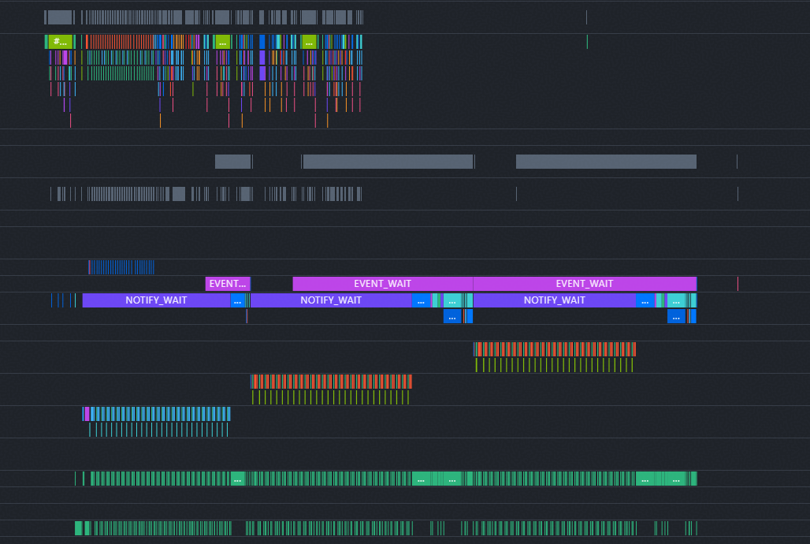

**图12 异步调度效果示意图**

**表3 异步调度性能测试结果**

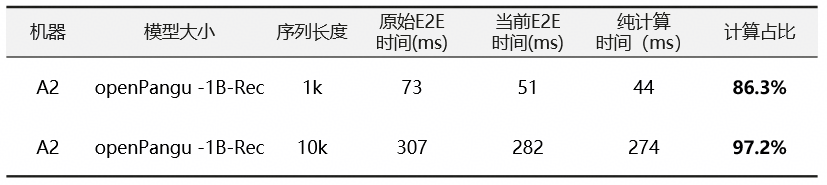

### 4.3 LiteScheduler：轻量化框架加速

现有通用推理框架（如vLLM）在处理LLM请求时，其调度与数据预处理阶段包含大量面向投机推理、长序列管理等场景的前置逻辑（如 \_update\_states、prepare\_inputs 中部分函数）。然而，生成式推荐采用固定次数自回归生成语义ID的方式，其中大量计算处理逻辑并不适用，直接复用框架会导致不必要的CPU开销和内存拷贝，增加端到端延迟。据统计，调度部分及数据预处理部分耗时占比高达 20%~30%, 是端到端时延优化的重点。

针对上述问题，GR-Scheduler对推理前置处理阶段进行轻量化加速，主要包括以下工作：

系统梳理并移除 \_update\_states、\_prepare\_inputs 等函数中与生成式推荐场景无关的计算逻辑（比如\_update\_states 中对“持久化批次”进行压缩、重排序、刷新等操作对于生成式推荐推理是冗余的，\_update\_states 中无需更新 token\_ids表，仅需更新block table 表。\_update\_states 前 scheduler\_output 输出的prompt\_token\_ids 可以直接透传给到 \_prepare\_inputs 函数处理，无需 \_update\_states中的 token\_ids 表中转等 ），保留必要的数据准备流程，显著降低预处理开销。如表4所示，优化后decode前调度部分时间从5.5ms降低到2.5ms, 调度部分时间在decode端到端时间占比从23.2%降低到14.8%，整体推理延迟得到有效降低。

**表4 调度及数据预处理部分优化效果数值测试**

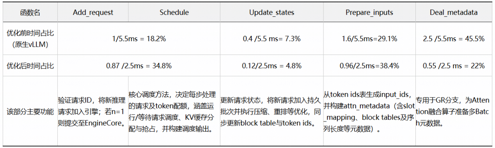

## 五、 生成式推荐异构池化加速 GR-Cache

由第一章分析可知，KV Cache规模膨胀与远端拉取时延是制约大规模部署的又一关键瓶颈。推荐系统需为每个用户维护独立的KV Cache，总规模随模型参数量、序列长度和并发量增长，极易突破百TB量级，远超片上内存容量上限。本章围绕这一瓶颈，从存储架构、缓存管理与传输引擎三个层面设计异构池化加速方案GR-Cache。

### 5.1 User-Wise KVCache Manager：用户粒度KV管理

初期方案选型阶段我们直接复用了vLLM中成熟的Block粒度KV Cache管理方式，该机制以固定大小的物理块为单位进行分配、回收和前缀匹配，在通用LLM的自回归推理中已得到广泛验证。然而在生成式推荐场景的测试中，该方案暴露出两类典型的适配问题。第一类发生在不带序列的请求上。推荐场景中部分Decode请求仅携带用户ID，不包含用户行为序列。传统前缀匹配机制依赖序列内容生成哈希键，空序列导致无法构建有效索引，缓存完全不可复用。第二类来自尾部截断问题。在Block粒度管理下，若用户KV序列未能完整填满最后一个Block，该尾部通常不会被保存，也不参与后续的前缀匹配。这导致用户最新的一部分行为历史在请求间丢失，即使序列逻辑一致，匹配也会在此处断裂，被迫触发重计算。

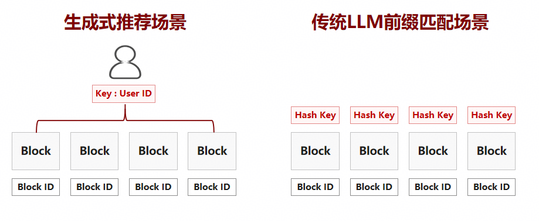

**图13 不同粒度的 KV Cache 管理方式**

如图13所示，上述问题揭示了Block粒度与推荐推理之间的结构性矛盾：推荐推理以用户为中心，而Block粒度以物理存储为中心。将其直接应用于以用户为边界的序列数据，会引入三方面代价。其一为碎片化。Block级别的淘汰以块为单位进行，一个用户的KV可能被部分淘汰、部分留存，留存块无法形成完整可用的序列，却持续占用显存空间，降低存储池有效利用率。其二为序列完整性损失。最后一个未满Block被丢弃的做法，本质上以截断用户最新行为为代价换取实现简洁性，对推荐精度与时延造成持续影响。其三为元数据开销。以Block为管理单位，每个用户往往关联数十甚至上百个块的映射关系，引用计数、LRU链表等维护成本随用户规模增长显著膨胀。用户粒度管理可直接按用户ID索引，减少池化存储需要维护的元数据开销与访问复杂度，相关性能数据见表5。

**表5 不同粒度 KV Cache 管理方式查询开销**

| Num\_Block | Block\_Size | 指标 | User粒度  (1 key-N blocks) | Block粒度  (N keys-N blocks) | 性能收益 |
| --- | --- | --- | --- | --- | --- |
| 16 | 512KB | PUT(D2H)耗时(ms) | 0.71 | 0.75 | -0.04 |
| 16 | 512KB | GET(H2D)耗时(ms) | 0.56 | 0.59 | -0.03 |
| 16 | 1024KB | PUT(D2H)耗时(ms) | 1.06 | 1.12 | -0.05 |
| 16 | 1024KB | GET(H2D)耗时(ms) | 0.89 | 0.91 | -0.02 |
| 64 | 512KB | PUT(D2H)耗时(ms) | 1.96 | 2.27 | -0.31 |
| 64 | 512KB | GET(H2D)耗时(ms) | 1.68 | 1.94 | -0.26 |
| 64 | 1024KB | PUT(D2H)耗时(ms) | 2.73 | 3.08 | -0.34 |
| 64 | 1024KB | GET(H2D)耗时(ms) | 2.85 | 3.07 | -0.22 |

综合上述问题，GR-Cache将管理粒度从物理块改进为用户维度，以每个用户的完整历史序列作为不可分割的缓存单元，对应一次分配、一次淘汰。淘汰操作以用户为粒度整体回收，不会产生块级碎片，存储空间的连续性与可用性得到保证。同一用户的KV可完整驻留在单节点上，为后续分布式内存池的亲和调度创造了条件，跨节点数据搬运概率大幅降低。

### 5.2 LiteCache：Cache多级缓存及Embedding与KV联合管理

在明确用户粒度管理方式后，容量问题随之凸显。生成式推荐场景的并发用户量可达百万级，乘以单个用户的KV Cache体积，总存储需求迅速膨胀至PB级别，而单卡片上内存容量仅为数十GB。因此，GR-Cache选择构建片上内存加分布式DRAM池的两级存储架构。在DRAM层，系统接入Mooncake内存池化方案，将集群内多节点的DRAM抽象为统一内存池，由Mooncake提供弹性扩展、自动分配回收与碎片整理能力。片上内存作为L1缓存，保留高频活跃用户的KV Cache，并使用LRU策略进行管理；Mooncake管理的DRAM池作为L2，承载全量或大量用户KV数据。

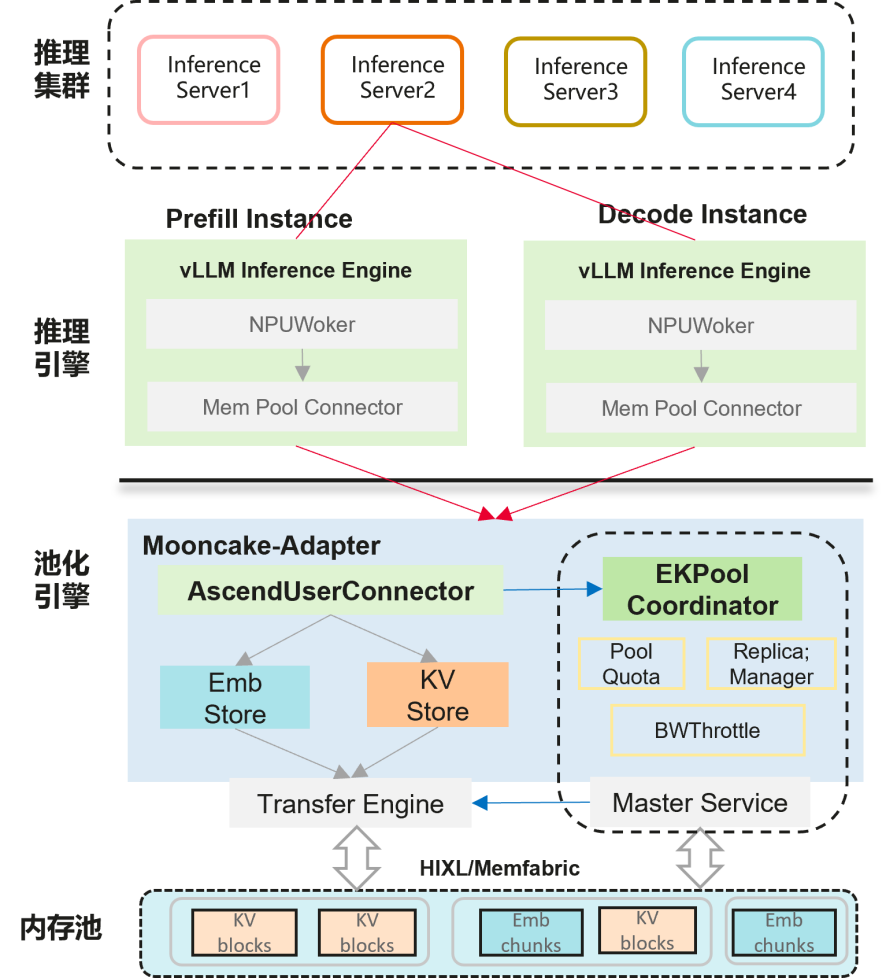

**图14 KV Cache多级缓存和联合管理示意图**

然而，KV Cache的容量问题并非孤立存在，在推荐场景下Embedding Table同样规模巨大（典型场景达数百 GB），且其稀疏随机访问模式与KV的序列式存取差异显著。若仅依赖片上内存存放Embedding，存储空间依然是挑战；若采用传统PS架构远端查询，RPC序列化开销和网络往返延迟常达数十毫秒，叠加到端到端时延后难以保证小于100ms的时延要求。若将Embedding Table和KV Cache二者分别交由独立外部存储管理，不仅增加系统复杂度，还可能导致跨节点重复传输、资源利用率低下。

基于此，如图14所示，我们提出EKPool（Embedding &amp; KV Pool），将两种缓存的存储管理纳入统一的池化框架。EKPool 在 Mooncake物理内存池之上通过逻辑语义分离实现协同管理，核心组件包括：EmbAdaptStore（分块存储/稀疏查找/NPU缓存预取）、KVAdaptStore（用户级KVCache布局与layer-wise存取）以及 Coordinator（全局系统调度）。在收益方面，相比“PS+Mooncake”的简单叠加，EKPool 的结构性优势更为显著：通过协同编排传输流程，消除独立调度间的冗余等待与冲突，从而将端到端时延进一步降低30%–40%。同时，统一管理缓存空间使得数据块的分配与淘汰策略更加全局最优，有效提升存储资源利用率。而在带宽资源紧张时，联合调度能按优先级统一协调各请求的带宽占用，避免争抢导致的性能抖动，保证整体吞吐的平稳性。

### 5.3 LiteTransfer：传输引擎优化

LiteCache存储架构解决了缓存的容量问题，却将传输环节推向了性能瓶颈的位置。在片上内存与Mooncake管理的DRAM池之间，换入换出依赖底层数据传输引擎完成，而推荐场景的时延敏感特性意味着任何额外搬运开销都可能直接突破SLA约束。

在生成式推荐场景中，单个用户序列可达8K甚至更长，对应的KV Cache block数量动辄数十上百。以 8K 序列、16 层模型为例，单次请求需完成1024 次串行put()/get()调用，即使单次调用延迟控制在 50μs 量级，累积延迟仍达1024 × 50μs = 51.2ms。如图15所示，进一步分析发现，拉取长序列KV Cache时，频繁下发传输指令会导致Host Bound。即使每次调用仅搬运单个block的单次有效负载并不算小，但反复触发DMA doorbell与PCIe指令，使协议头开销与调度损耗持续累积，因此必须将多次小传输合并为单次大传输。

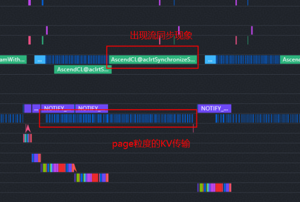

**图15 数据传输存在的问题**

基于这一判断，GR-Cache设计了离散Paged KV聚合传输方案LiteTransfer，整体流程如图16所示。优化后的效果可概括为：一次调用内，每层仅下发一次传输算子，完成该层所有block的批量搬运，不再逐block串行触发。原先1024次调用对应的算子下发与调度开销聚合为单次，消除了page粒度下发产生的空泡。

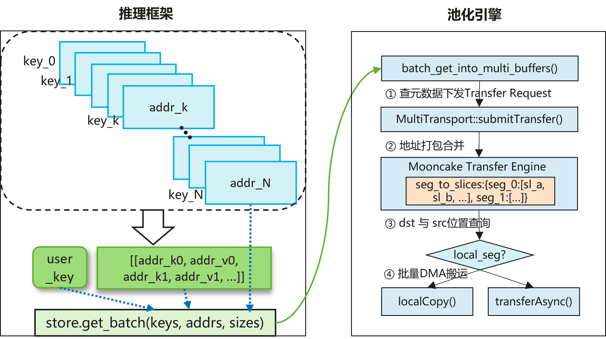

**图16 离散Paged KV聚合传输方案**

测试结果验证了该方案的实际收益，如表6所示。相比逐page下发的MemcpyAsync传输，聚合传输在小包场景（block-size为128KB）下带宽提升12%，在大包场景（block-size为1024KB）下带宽提升34%，并且单次传输的block数量越多带宽性能越优。更为关键的是，Python侧串行循环所引发的host-bound问题被彻底消除，传输延迟显著下降。

**表6 传输方式优化性能对比**

**Model 0.1B  (Emb\_dim=1024,Num\_layer=8, D\_type=FP16)**

| Block\_size | 序列长度 (Tokens) | 传输数据量(MB) | H2D耗时（ms） / 原始 | H2D耗时（ms） / Page聚合 | H2D带宽(GB/s) / 原始 | H2D带宽(GB/s) / Page聚合 | 带宽提升率 |
| --- | --- | --- | --- | --- | --- | --- | --- |
| 32 | 2K | 64 | 9.42 | 8.39 | 6.63482 | 7.449344 | 12% |
| 32 | 4K | 128 | 18.73 | 13.175 | 6.673785 | 9.487666 | 42% |
| 64 | 2K | 64 | 6.28 | 5.26 | 9.952229 | 11.88213 | 19% |
| 64 | 4K | 128 | 10.98 | 7.53 | 11.38434 | 16.60027 | 46% |
| 128 | 2K | 64 | 5.65 | 4.56 | 11.06195 | 13.70614 | 24% |
| 128 | 4K | 128 | 9.03 | 6 | 13.84275 | 20.83333 | 51% |
| 256 | 2K | 64 | 4.77 | 3.03 | 13.10273 | 20.62706 | 57% |
| 256 | 4K | 128 | 7.86 | 5.88 | 15.90331 | 21.2585 | 34% |

### 5.4 Fullgraph Layerwise Pipeline：整图下计算流与池化load的掩盖方案

当把用户历史序列产生的 KV 通过Mooncake Store卸载到分布式 DRAM 池，如何高性能地按需取回已从可选优化变为架构刚需。由于整图执行要求模型 forward 的全部算子（含层间同步）在 capture 阶段即被记录入图，replay期间host 不再介入。然而，Mooncake 的池化读取接口 batch\_get\_into\_multi\_buffers 通过host 侧future.get() 感知传输完成，无法直接被图内device stream识别，导致传统方案只能退化为 piece-wise graph。

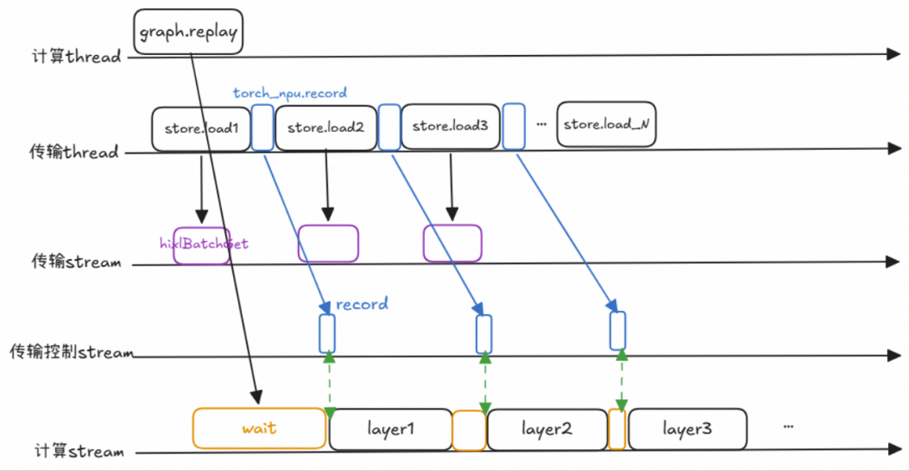

**图17 整图下计算与池化load layerwise掩盖示意图**

针对上述矛盾，如图17我们构建了一种零侵入 Mooncake 的 Fullgraph layerwise KV传输机制：将 host 可见的 KV 到达信号转换为 device 可感知的同步事件，使整图执行和逐层 KV 加载可以同时成立。具体而言，在图 capture 阶段，仅在层间插入 ExternalEvent.wait/reset 作为 device 侧动态依赖节点，保证图内不存在任何 host 调用；在 replay 阶段，由独立 load 线程逐层调用 Mooncake KV 拉取接口，当某层 KV 传输完成后，通过 ExternalEvent.record() 将 host 侧完成状态映射为 device event。这样，计算图可以一次性 replay，计算流在执行到对应 Attention 层前自动等待 KV 到达，而后台 load 线程持续准备后续层 KV，实现 layeri 的 KV 传输与 layeri-1 的 Attention 计算在 device 侧重叠，从而使当前池化卸载架构能够获得Fullgraph带来的调度收益。

## 六、 生成式推荐推理系统性能分析

为评估本文提出的优化效果，以将模型适配后接入vLLM并进行向量并行化优化后的版本作为Baseline。在相同硬件环境和请求下进行性能测试，测试结果如下：A2机器，openPangu-1B-Rec模型1k/10k序列128 beam width端到端时延46/261ms，端到端性能提升94.4% / 93.4%；950机器，openPangu-1B-Rec模型1k/10k序列128 beam width端到端时延27/114ms，端到端性能提升93.3% / 93.3%；性能测试结果见表7。各优化技术点对应的时延收益见图18。

**表7 openPangu-1B-Rec模型性能测试对比**

| 机器 | 模型大小 | 序列长度 | Beam Width | Prefill时间(ms) | Decode时间(ms) | E2E 时间v3 (ms) | E2E 时间v2 (ms) | E2E 时间v1 (ms) | Baseline (ms) |
| --- | --- | --- | --- | --- | --- | --- | --- | --- | --- |
| A2 | openPangu-1B-Rec | 1k | 128 | 24 | 22 | 46 | 169 | 230 | 822 |
| A2 | openPangu-1B-Rec | 10k | 128 | 230 | 31 | 261 | 513 | 1330 | 3951 |
| 950 | openPangu-1B-Rec | 1k | 128 | 11 | 16 | 27 | 92 | 108 | 403 |
| 950 | openPangu-1B-Rec | 10k | 128 | 94 | 20 | 114 | 313 | 499 | 1709 |

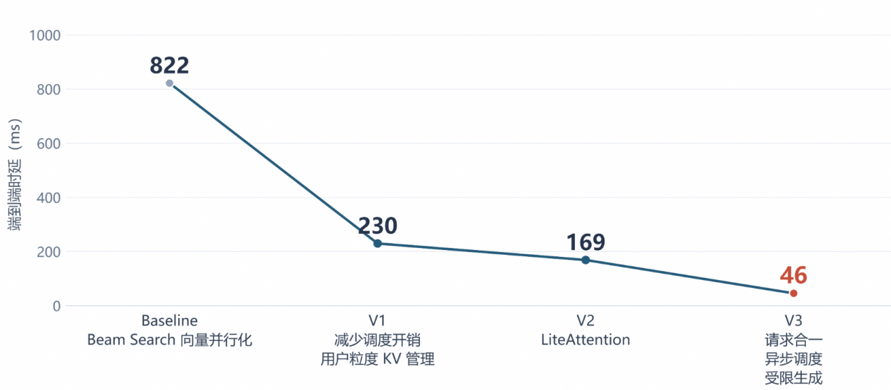

**图18 时延收益示意图**

## 七、 总结与展望

### 7.1 工作总结

本文面向生成式推荐推理场景，针对其低时延、高并发、大存储的三重挑战，设计并实现了低时延生成式推荐推理系统openPangu-GenRec-Infer。在openPangu的低时延推荐系统实践中，通过低时延推理引擎、调度并发优化和异构池化加速模块，数值实验结果表明，openPangu-GenRec-Infer 在真实业务场景下相比基线版本取得了显著的性能提升。相关系统已在终端云上线部署，为基于昇腾的生成式推荐推理提供了重要实践支撑，openPangu团队已将多个技术合入vLLM社区开源项目vLLM-GR（https://github.com/vllm-project/vllm-gr）并参与共建。

### 7.2 未来工作与 Roadmap

如图19所示，基于现有工作，openPangu-GenRec-Infer 将进一步向更高效、更智能的推理系统演进。未来工作将围绕以下方向展开：

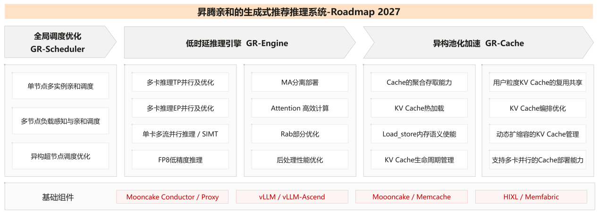

**图19 未来工作Roadmap**

**一、全局调度能力：**

当前GR-Scheduler主要聚焦单节点内的并发调度与流程优化，尚未涉及跨节点的请求分配与资源协同。面向更大规模集群部署，GR-Scheduler将进一步拓展为全局调度能力，实现三个层次的调度优化：

1）单节点多实例亲和调度：根据负载与硬件拓扑动态绑定资源，减少资源争用与实例间干扰。

2）多节点负载感知与亲和调度：在集群层面感知各节点的负载状态和用户KV分布，将请求调度到最优节点，实现全局负载均衡与亲和性调度。

3）异构超节点调度优化探索：面向未来更大规模的异构超节点/融合超节点环境，研究跨异构计算单元的任务调度与资源分配策略。

**二、推理引擎增强：**

1）单卡多流与950 SIMT深度融合：将推理任务细粒度拆解为算子流，利用950 SIMT特性将算子精准映射至 Vector 核、Cube 核等最匹配单元，实现“专核专用”，进一步提升单卡利用率。

2）多卡推理性能优化：优化多卡并行（TP/EP）的通信模式与负载均衡，降低跨卡同步开销。

3）FP8 低精度推理：探索FP8等低精度推理方案，在保证模型精度的前提下进一步降低计算与存储开销。

**三、异构池化扩展：**

1）结合950使能UB：利用950 UB的Load-Store内存语义优势，加速片上内存与内存池间的数据移动，降低传输延迟。

2）用户粒度KV Cache的复用与共享：基于不同用户间的相似性，实现用户粒度的KV复用与共享，从而大幅降低存储压力。

3）KV Cache编排优化：设计更智能的KV Cache布局与编排策略，提升多用户并发场景下的缓存复用效率。

上述工作将分阶段逐步落地，持续推动 openPangu-GenRec-Infer 在生成式推荐推理场景中的性能与可扩展性提升。

## 参考文献

【1】Wang J, Huang P, Zhao H, et al. Billion-scale commodity embedding for e-commerce recommendation in alibaba\[C\]//Proceedings of the 24th ACM SIGKDD international conference on knowledge discovery &amp; data mining. 2018: 839-848.

【2】Zhai J, Liao L, Liu X, et al. Actions speak louder than words: Trillion-parameter sequential transducers for generative recommendations\[J\]. arXiv preprint arXiv:2402.17152, 2024.

【3】Deng J, Wang S, Cai K, et al. Onerec: Unifying retrieve and rank with generative recommender and iterative preference alignment\[J\]. arXiv preprint arXiv:2502.18965, 2025.

【4】Han R, Yin B, Chen S, et al. Mtgr: Industrial-scale generative recommendation framework in meituan\[C\]//Proceedings of the 34th ACM International Conference on Information and Knowledge Management. 2025: 5731-5738.

【5】Chai Z, Ren Q, Xiao X, et al. Longer: Scaling up long sequence modeling in industrial recommenders\[C\]//Proceedings of the Nineteenth ACM Conference on Recommender Systems. 2025: 247-256.

【6】Zhang Z, Pei H, Guo J, et al. Onetrans: Unified feature interaction and sequence modeling with one transformer in industrial recommender\[C\]//Proceedings of the ACM Web Conference 2026. 2026: 8162-8170.

【7】Ding Q, Course K, Ma L, et al. Bending the scaling law curve in large-scale recommendation systems\[J\]. arXiv preprint arXiv:2602.16986, 2026.

【8】Qin R, Li Z, He W, et al. Mooncake: Trading more storage for less computation—a {KVCache-centric} architecture for serving {LLM} chatbot\[C\]//23rd USENIX conference on file and storage technologies (FAST 25). 2025: 155-170.
